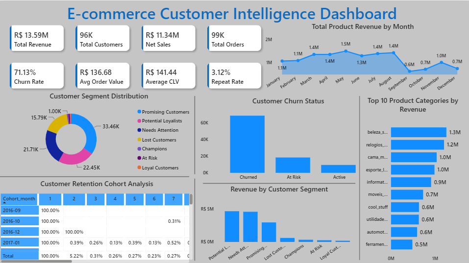

# E-commerce Customer Intelligence Platform

Customer behavior, retention, segmentation, and purchasing pattern analysis using Python, SQL, and Power BI.

## Project Overview

This project analyzes e-commerce customer and transaction data to understand purchasing behavior, customer value, retention, churn, segmentation, product performance, and payment behavior.

The project follows an end-to-end analytics workflow:

**Data Cleaning → Exploratory Analysis → Customer Analysis → RFM Segmentation → Retention Analysis → CLV → Churn Analysis → SQL Analysis → Power BI Dashboard → Business Insights**

## Business Objectives

- Analyze customer purchasing behavior
- Identify valuable and at-risk customer segments
- Measure customer retention and churn
- Analyze repeat-purchase behavior
- Estimate Customer Lifetime Value (CLV)
- Identify high-performing product categories
- Analyze payment-method revenue
- Build an executive Power BI dashboard
- Generate actionable business recommendations

## Tools & Technologies

- Python
- Pandas
- NumPy
- Matplotlib
- SQLite
- SQL
- Power BI
- DAX
- Git & GitHub

## Analysis Performed

### Customer Behavior Analysis

Analyzed customer orders, spending, purchasing frequency, and revenue contribution to understand overall customer behavior.

### RFM Segmentation

Used Recency, Frequency, and Monetary analysis to classify customers into segments including:

- Champions
- Loyal Customers
- Potential Loyalists
- Promising Customers
- Needs Attention
- At Risk
- Lost Customers

### Customer Lifetime Value

Estimated Customer Lifetime Value using historical customer purchasing behavior to identify differences in customer value.

### Customer Churn Analysis

Classified customers based on their recent purchasing activity into Active, At Risk, and Churned groups.

### Retention Analysis

Performed cohort-based retention analysis to measure how customer purchasing activity changes across subsequent months after the initial purchase.

### SQL Analysis

Created a relational SQLite database containing the e-commerce datasets and performed analytical queries using joins, aggregations, CTEs, and window functions.

### Power BI Dashboard

Built an executive dashboard containing:

- Total Revenue
- Total Customers
- Total Orders
- Average Order Value
- Repeat Customer Rate
- Churn Rate
- Net Sales
- Average CLV
- Customer Segment Distribution
- Payment Method Revenue
- Revenue by Customer Segment
- Monthly Product Revenue
- Top 10 Product Categories by Revenue
- Customer Spending by Segment
- Customer Churn Status
- Retention Cohort Matrix

## Key Business Insights

### 1. Customer retention is a major challenge

The analysis shows a **71.13% churn rate**, with approximately **68K customers classified as churned** and another **18K customers classified as at risk**.

This indicates a significant opportunity to improve customer retention and repeat purchasing.

### 2. A large portion of customers are early-stage or require attention

Promising Customers represent approximately **34.82%** of the customer base, while Needs Attention represents approximately **22.59%**.

Together, these segments account for approximately **57% of customers**, creating a substantial opportunity for conversion and re-engagement.

### 3. Repeat purchasing is low

The repeat customer rate is approximately **3.12%**, indicating that increasing second purchases and subsequent repeat orders is an important growth opportunity.

### 4. High-value customers should be protected

The analysis identifies approximately **752 Loyal Customers** and **1,002 Champions**, only about **1.8%** of all customers.

These customer groups should receive loyalty-focused engagement to strengthen long-term customer relationships.

### 5. Revenue is concentrated in leading product categories

The top three product categories — **Beleza Saúde, Relógios Presentes, and Cama Mesa Banho** — generate approximately **R₹3.51M** in combined revenue.

### 6. Credit cards dominate payment revenue

Credit cards account for approximately **78.34% of payment revenue**, while Boleto contributes approximately **17.92%**.

## Business Recommendations

1. Launch targeted retention campaigns for **At Risk** and **Needs Attention** customers.
2. Create conversion campaigns to encourage **Promising Customers** to make repeat purchases.
3. Develop loyalty strategies for **Champions** and **Loyal Customers**.
4. Use personalized offers and cross-selling around high-performing product categories.
5. Prioritize high-spending churned customers for targeted win-back campaigns.
6. Monitor **repeat-purchase rate and churn** as key customer-health KPIs.

## Key Dashboard Metrics

| Metric | Value |
|---|---:|
| Total Revenue | R$13.59M |
| Total Customers | 96K |
| Total Orders | 99K |
| Average Order Value | R$136.68 |
| Repeat Customer Rate | 3.12% |
| Churn Rate | 71.13% |
| Average CLV | R$141.44 |
| Net Sales | R$11.34M |

.
